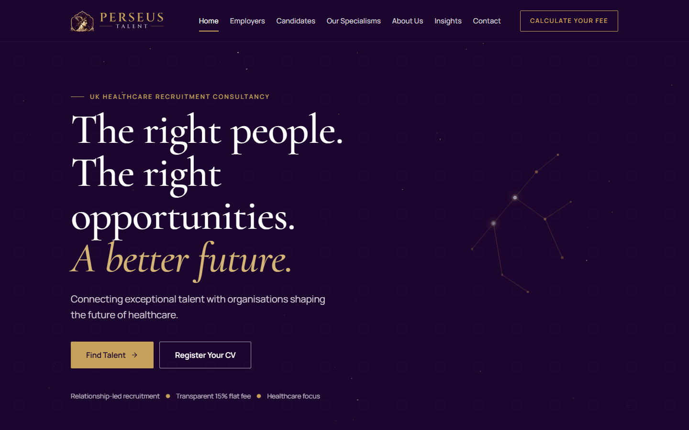
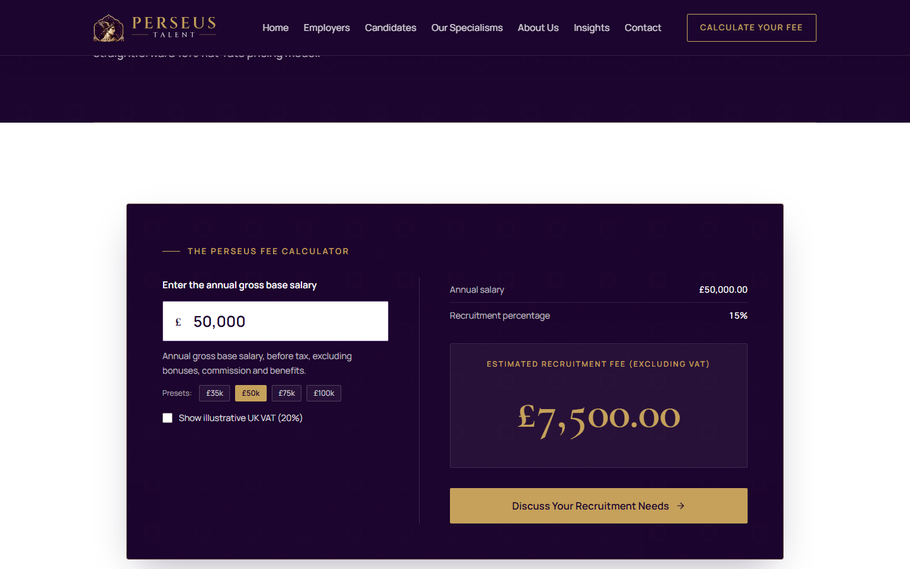
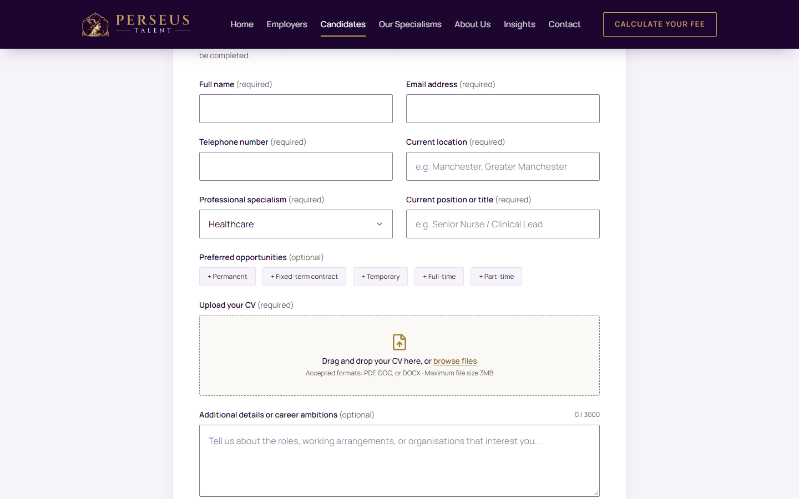

# Perseus Talent: UK Healthcare Recruitment Website

**Live site: [perseustalent.co.uk](https://www.perseustalent.co.uk)**

The production website for Perseus Talent, a UK recruitment consultancy in healthcare. I designed and built it end to end: brand system, front end, form handling, email delivery, testing and deployment.



## Highlights

- **Lighthouse 99–100 for performance, 100 for accessibility, best practices and SEO** on every key page ([reports](lighthouse-reports/))
- **Candidate CV registration** with drag-and-drop upload. Files are checked by their real content (magic bytes), not only by extension, and stored outside the public folder
- **Employer enquiry form** and an **interactive fee calculator** with live results and optional VAT
- **Spam and abuse protection**: Cloudflare Turnstile, server-side rate limiting and Zod validation on every request
- **Branded email notifications** through a delivery layer with a pluggable backend (local files in development, SMTP or Resend in production)
- **Content in MDX files** (insights articles and specialisms), checked against a Zod schema at build time
- **SEO built in**: generated sitemap, robots rules, Open Graph images and JSON-LD structured data
- **118 automated tests**: Vitest unit tests plus Playwright end-to-end, accessibility (axe) and SEO checks

| Fee calculator | Candidate registration | Mobile |
|---|---|---|
|  |  |  |

## Tech stack

| Area | Tools |
|---|---|
| Framework | Next.js 16 (App Router, Server Components), React 19, TypeScript |
| Styling | Tailwind CSS 4, self-hosted fonts |
| Forms and validation | Zod, libphonenumber-js |
| Email | Nodemailer (SMTP), Resend |
| Content | MDX with gray-matter and remark |
| Testing | Vitest, Playwright, @axe-core/playwright, Lighthouse |
| Hosting | Netlify, Cloudflare Turnstile |

## Project structure

```text
src/
  app/          routes: home, employers, candidates, fee calculator, insights, API
  components/   UI, forms, calculator, layout and SEO components
  lib/          fee maths, validation, rate limiting, file checks, email delivery
content/        MDX articles and specialisms
tests/          unit tests (Vitest) and e2e/a11y/SEO tests (Playwright)
scripts/        link checker, content audit, Lighthouse runner
```

## Run it locally

```bash
npm install
cp .env.example .env.local   # works out of the box: form submissions are saved locally
npm run dev                  # http://localhost:3000
```

| Command | What it does |
|---|---|
| `npm test` | Unit tests |
| `npm run test:e2e` | Playwright end-to-end tests |
| `npm run check:a11y` | Accessibility tests with axe |
| `npm run verify` | Lint, typecheck, tests, content audit and a production build checked in the browser |

More detail: [development guide](docs/DEVELOPMENT.md) · [deployment](docs/DEPLOYMENT.md)

## Author

Built by **Ali Hosseini**, full-stack developer. [LinkedIn](https://www.linkedin.com/in/ali-hosseini-dev/) · [GitHub](https://github.com/Ali-Black-Eagle)
